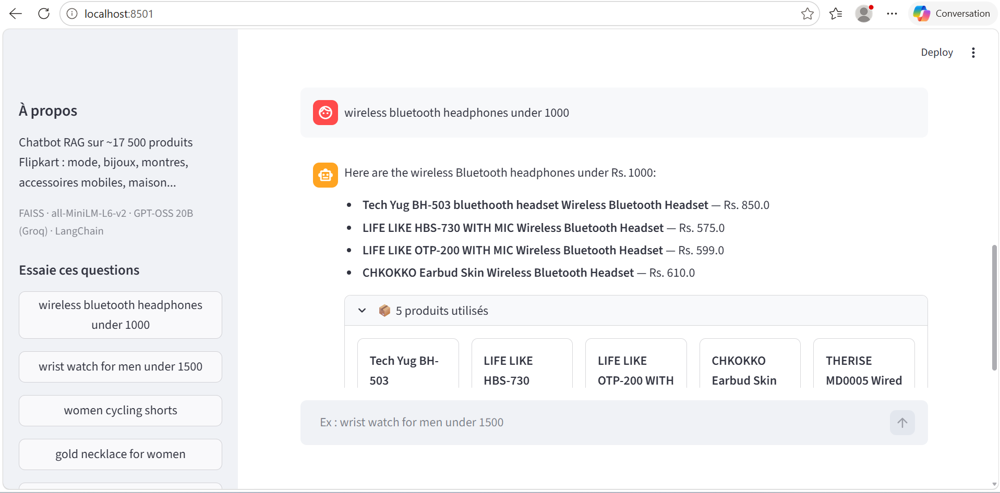

# 🛒 Flipkart AI Shopping Assistant (RAG)

A conversational e-commerce assistant that answers questions about ~17,500 Flipkart products using **Retrieval-Augmented Generation (RAG)**. It understands the intent of each message, retrieves the most relevant products with semantic search, and generates answers grounded in the catalog.

**Live demo:** coming soon



## Features

- **Query understanding**: an LLM turns each message into a structured request (intent, English search query, budget, brand)
- **Semantic search** over thousands of products (understands meaning, not just keywords)
- **Budget and brand filters** (e.g. "wrist watch for men under 1500")
- **Catalog questions**: broad questions like "do you have products for women?" return a per-category overview computed from the whole catalog
- **Conversational memory**: follow-ups such as "what about its price?" are resolved from the previous exchange
- **Grounded answers**: the LLM only uses retrieved products; product cards show price, discount and rating
- **Honest fallbacks**: when nothing matches, the assistant says so instead of inventing products
- **Multilingual input**: questions in other languages (e.g. French) are translated into an English search query by the LLM
- **Streamlit interface** with clickable example questions

## Architecture

```
User message
   │
   ▼
Query understanding (LLM → JSON: intent, English query, budget, brand)
   ├─ chitchat ──► friendly reply
   ├─ browse ────► catalog overview (counts per category) ──► LLM answer
   └─ search ────► embedding ──► FAISS top-80 ──► budget/brand filters ──► top-5
                                          │
                                          ▼
                    LLM (GPT-OSS 20B via Groq) ──► answer + product cards
```

## Tech stack

| Component | Tool |
|---|---|
| Language | Python 3.10 |
| Orchestration | LangChain |
| Embeddings | HuggingFace `all-MiniLM-L6-v2` (runs locally) |
| Vector database | FAISS |
| LLM | GPT-OSS 20B via Groq API |
| Data processing | pandas |
| Interface | Streamlit |

## Dataset

[Flipkart E-commerce sample dataset](https://www.kaggle.com/datasets/PromptCloudHQ/flipkart-products): 20,000 products, ~17,500 after cleaning and deduplication.
The catalog is mostly fashion (clothing, jewellery, footwear), watches, mobile accessories, and home and kitchen items. It contains very few smartphones or laptops.

## Project structure

```
├── build_index.py          # Cleans the data and builds the FAISS index (run once)
├── chatbot.py              # RAG logic: query understanding, retrieval, filters, generation
├── app.py                  # Streamlit interface
├── evaluate.py             # Retrieval evaluation (Precision@5)
├── diagnostic.py           # Dataset category overview
├── requirements.txt
├── .env.example
├── flipkart_faiss_index/   # Prebuilt vector index
├── docs/                   # Screenshot
└── data/                   # Place the Flipkart CSV here (not versioned)
```

## Installation

```bash
git clone https://github.com/JbeliEmna/flipkart-rag-chatbot.git
cd flipkart-rag-chatbot

python -m venv venv
venv\Scripts\activate        

pip install -r requirements.txt
```

1. Get a free API key at [console.groq.com](https://console.groq.com)
2. Copy `.env.example` to `.env` and paste your key
3. The vector index is already included. To rebuild it, download the dataset to `data/flipkart_com-ecommerce_sample.csv` and run `python build_index.py`

## Usage

```bash
python chatbot.py          # chat in the terminal
streamlit run app.py       # launch the web interface
```

Example questions:

- `wrist watch for men under 1500`
- `do you have products for women?`
- `wireless bluetooth headphones under 1000`
- `what about its price?`
- `montre pour homme moins de 1500`

## Evaluation

Retrieval quality is measured with `evaluate.py` on 10 hand-written queries
(a result counts as relevant if its name or category contains an expected keyword).

```bash
python evaluate.py
```

**Precision@5: 98%**

This measures the search step only, on a small test set. It is not an end-to-end accuracy score.

## Limitations and future work

- Some products have no price or brand in the dataset (shown as "price not listed")
- Product variants with identical names are shown once
- Category counts in catalog questions are lower bounds: they only include products whose name or category explicitly mentions the keyword
- The embedding model is English-only; a multilingual embedding model would improve non-English queries
- Free-tier Groq rate limits apply
- Possible additions: side-by-side product comparison, hybrid search (BM25 + vectors), a larger evaluation set

## Author

Jbeli Emna, [LinkedIn] https://www.linkedin.com/in/emna-jbeli